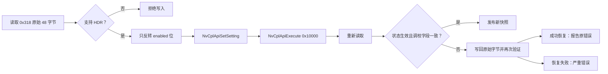
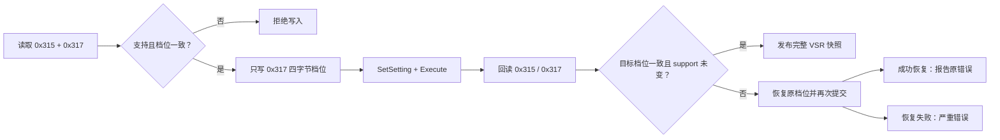
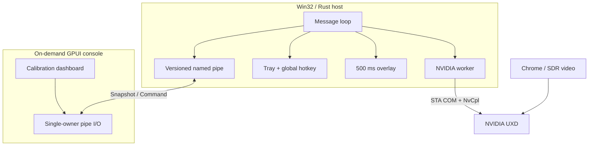

<div align="center">


# RTX Video Manager

**一块控制台，接管 RTX Video HDR + VSR。不是更多面板，而是更快地做对视觉决定。**

<p>
  
  
  
</p>

`Ctrl+Alt+H` 切换 HDR · `Ctrl+Alt+V` 切换 VSR · `Ctrl+Alt+G` 唤起/收起控制台 · 500 ms 浮层 · 双通道严格回滚


</div>

---

## 为什么要做这个工具？

RTX Video HDR 不是万能滤镜。
2D 动画、动态图形、AE 合成、大面积纯白背景和强 UI 画面经常会被“提亮过头”：

- 白色字幕和小图形出现过曝或边缘发灰。
- 原本平面的动画出现不自然的明暗层次。
- 对比度被拉高后，线稿和色块不再干净。
- 去 NVIDIA App 里翻 `System → Video → HDR`，再切回播放器，太过繁琐。

这就不合理了。一个高频、瞬时、情境化的视觉判断，不应该要求你离开视频页面、
找到显卡控制面板、翻开多层设置，然后再回来继续看。

> **核心痛点：HDR 和超分是否合适是“逐视频”的，但两个入口却都藏在“系统级”驱动面板里。**

---

## 30 秒认识它

| 你可能正在经历 | 使用之后 |
| --- | --- |
| 为了关 HDR，打开 NVIDIA App 翻三层菜单 | `Ctrl+Alt+H`，一次按键 |
| 想让动画改用更高档 VSR，又要翻驱动设置 | `Ctrl+Alt+V`，再用控制台选 Auto / 1–4 |
| 想改 HDR 峰值或调色，又要重新翻驱动面板 | `Ctrl+Alt+G` 打开控制台，滑块与数值直接调 |
| 控制台挡在视频前，还要去点关闭 | 控制台在前台时再按 `Ctrl+Alt+G`，立即收起 |
| 不确定当前设置到底是开还是关 | 托盘图标和控制台实时显示状态 |
| 切完不知道有没有生效 | 500 ms 屏幕下方浮层即时反馈 |
| 担心修改 HDR 弄坏其他调校参数 | 严格读—改—写—回读—回滚事务 |
| 想看诊断信息又被大而全的驱动面板淹没 | 专用 GPUI 控制台只展示相关指标 |
| 想同时管理 HDR 与 VSR，但不想常驻 WebView | 轻量 Win32 宿主 + 按需 GPUI 双功能控制台 |

---

## 功能地图

```text
┌──────────────────────────────────────────────────────────────┐
│                        Windows 桌面                          │
│                                                              │
│   Ctrl+Alt+H ─────┤                                          │
│   Ctrl+Alt+V ─────┤                                          │
│   Ctrl+Alt+G ─────┤                                          │
│                    ▼                                          │
│   ┌─────────────────────────┐       ┌────────────────────┐   │
│   │ RtxVideoManager.exe     │◀─────▶│ RtxVideoManager-   │   │
│   │                         │       │ Console.exe        │   │
│   │ Win32 resident host     │ IPC   │ GPUI console       │   │
│   └───────────┬─────────────┘       └────────────────────┘   │
│               │                                                │
│       ┌───────┴────────┐                                       │
│       ▼                ▼                                       │
│  托盘子菜单        500 ms 原生浮层                             │
│       │                                                        │
│       ▼                                                        │
│  NVIDIA UXD / HDR 0x318 / VSR 0x315+0x317                    │
└──────────────────────────────────────────────────────────────┘
```

### 宿主能力

- 默认快捷键 `Ctrl+Alt+H` 切换 HDR，`Ctrl+Alt+V` 切换 VSR，`Ctrl+Alt+G` 唤起或收起控制台，均可重新录制。
- 通知区域常驻，左键打开控制台，右键打开原生菜单。
- 开机启动默认开启，可随时关闭。
- 切换成功后在当前显示器底部居中显示 **500 ms**、50% 透明度的 HDR/VSR 状态提示。
- 托盘图标区分开启、关闭和不可用状态。
- Explorer 重启后自动重建托盘图标。

### 控制台能力

- 大号 HDR 状态，以及来自驱动 `0x318` 的峰值、峰值上下限、中间灰、对比度和饱和度。
- 直接开启/关闭 RTX Video HDR。
- 直接开启/关闭 RTX VSR，并在 `Auto`、`1`、`2`、`3`、`4` 之间选择质量。
- `总览 / HDR / VSR / 设置 / 诊断` 五页结构；总览同时显示两个增强通道。
- 总览采用双卡并列：HDR 峰值刻度、VSR 质量阶梯、独立开关和底部状态轨在同一视野完成判断。
- HDR/VSR 详情页采用主卡 + 右侧驱动/当前视频信息卡，保持与 HTML 原型一致的视觉节奏。
- 峰值亮度、中间灰、对比度、饱和度均支持滑块和直接数值输入。
- `还原`无论何时点击都恢复驱动默认组合：峰值上限、中间灰 50、对比度 0、饱和度 0。
- HDR 调校卡片会撑满剩余页面高度并保持圆角包裹，底部状态行不会被页脚截断。
- 三个全局快捷键均可可视化录制，且任意两个不能重复。
- 开机启动与切换浮层开关。
- NVIDIA DLL 路径、允许哈希、错误码、HDR 调校字段、VSR 原始 `0x315/0x317` 与最近错误。
- 关闭窗口即退出 GPUI，释放渲染资源；托盘宿主继续工作。

---

## 快速开始

### 1. 获取发布包

从 GitHub Actions 最新绿色 `build` run 下载：

```text
RtxVideoManager-win-x64.zip
```

### 2. 完整解压

压缩包内至少需要这两个文件处在同一目录：

```text
RtxVideoManager.exe
RtxVideoManagerConsole.exe
```

### 3. 启动宿主

运行 `RtxVideoManager.exe`。首次启动会打开控制台，并默认写入当前用户开机启动项。

### 4. 开始切换

在 Chrome 播放 SDR 视频时按：

```text
Ctrl + Alt + H
```

看到屏幕下方出现 `RTX HDR 开启` 或 `RTX HDR 关闭` 即表示本次事务成功。

也可按 `Ctrl + Alt + V` 独立切换 VSR。退出工具不会主动改变当前 HDR/VSR 状态；
关闭控制台也不会退出后台宿主。

---

## 安全设计，不是“调个私有 DLL”这么简单

RTX Video HDR 没有 NVIDIA 官方公开 CLI 或支持的公共 API。本项目直接操作 NVIDIA App
使用的私有 `nvcpl.dll` 设置 `0x318`，因此对写入门槛设置了多层硬门：

| 门禁 | 行为 |
| --- | --- |
| 固定路径 | 只接受 `%ProgramW6432%\NVIDIA Corporation\NVIDIA App\NvCpl\nvcpl.dll` |
| 固定 SHA-256 | `eee812ab8ff74975d3cc7fe77130f5766911b6ca2d9c42c1156376a6c13f79f0` |
| Authenticode | 签名验证失败直接只读 |
| 必需导出 | Init / Get / Set / Close / Execute / UXD 服务检查 |
| STA COM | NVIDIA worker 独立初始化 STA |
| UXD 服务 | 服务未运行时禁止写入 |
| 48 字节读探针 | 字段或错误码异常时禁止写入 |
| VSR 双读探针 | `0x315` 与 `0x317` 档位一致后才允许操作 |
| Set + Execute | 写入后执行 `0x10000` 提交事务 |
| 回读确认 | 目标状态与六个调校字段逐项核对 |
| VSR 固定字段 | 只比较 support、quality、status，不把易变尾部当写条件 |
| 自动回滚 | HDR 恢复原始 48 字节，VSR 恢复并重新提交原档位 |

### 事务流程



### VSR 事务



`Auto=5`，`Off=0`，画质档位 `1..=4`。VSR 关闭时改档位只改变“下次启用质量”，
不会调用 NVIDIA 写接口。不会访问已知会触发访问冲突的 `0x31b`。

**不修改 NVIDIA 驱动注册表。不自动化点击 NVIDIA App。不切换 Windows HDR。**

---

## 架构：轻宿主，按需前端



### 两个进程的分工

| 进程 | 职责 | 生命周期 |
| --- | --- | --- |
| `RtxVideoManager.exe` | 托盘、三组热键、自启、HDR/VSR 事务、IPC 服务、原生浮层 | 常驻 |
| `RtxVideoManagerConsole.exe` | 五页仪表盘、设置草稿、快捷键录入、双功能诊断 | 按需启动，关闭即退出 |

宿主**不链接 GPUI**。只有你真正打开控制台时才启动渲染器，所以每次按快捷键都不会
拉起 GPU 窗口，也不会把渲染内存长期挂在后台。

## 兼容状态

| 状态 | 程序行为 |
| --- | --- |
| 受支持 + HDR10 显示器 + Windows HDR 开启 | 允许切换 |
| VSR 支持且 `0x315`/`0x317` 读取一致 | 允许 VSR 开关与档位写入 |
| 未找到 HDR10 显示器 | 只读，提示错误码 1 |
| Windows HDR 未开启 | 只读，提示错误码 2 |
| NVIDIA Surround 开启 | 只读，提示错误码 3 |
| 哈希未验证，但 NVIDIA 签名、导出和 HDR/VSR 探针均通过 | 只读兼容，只显示状态与诊断 |
| 签名、导出或读取探针失败 | 功能不可用，禁止写入 |
| UXD 服务不可用 | 只读 |
| 写入或回读不一致 | 自动恢复原始状态 |

### 参考环境

- Windows 10 Pro build 26300 / 26H2
- NVIDIA GeForce RTX 5060
- NVIDIA 驱动 `621.01`
- NVIDIA App `11.0.9.565`
- `nvcpl.dll` `8.17.15.5527`
- Chrome 155

其他驱动或 NVIDIA App 版本可能改变私有 ABI。未知哈希只有在 NVIDIA 签名、导出和
HDR/VSR 探针全部通过时才进入只读兼容；任何一项失败都会关闭写入路径。

---

## 性能目标

| 指标 | 目标 / 观察值 |
| --- | --- |
| 宿主 EXE | 约 0.5 MB |
| GPUI 控制台 EXE | 约 17.7 MB |
| 宿主空闲私有内存 | 约 6–13 MB |
| 控制台私有内存 | 实测约 90–100 MB，仅在打开时存在 |
| 空闲 CPU | 接近 0 |
| 切换浮层 | 500 ms |
| IPC 帧 | 长度前缀 JSON，≤ 64 KiB |

> 控制台不是常驻进程。关闭后，GPU 渲染内存随之释放。

---

</div>
