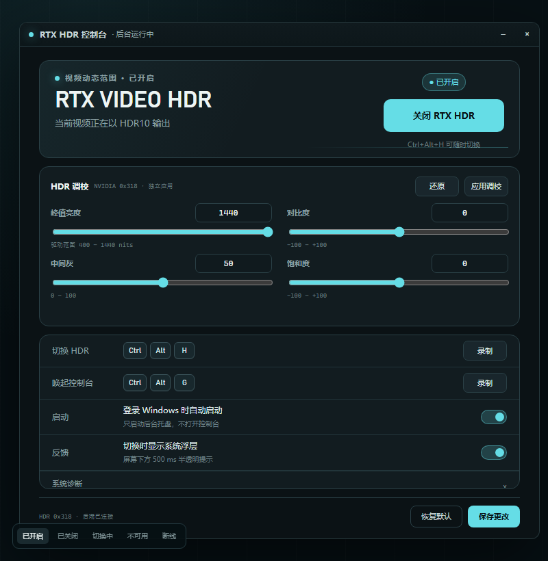
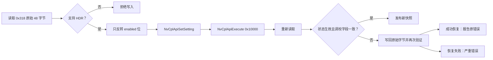
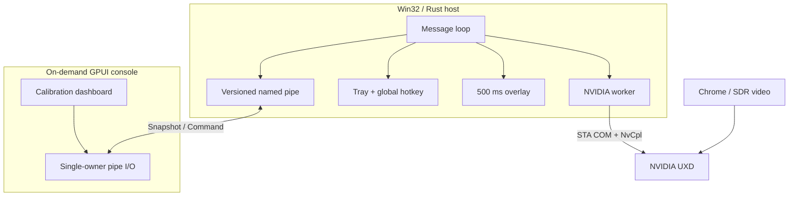

<div align="center">


# RTX HDR Switch

**一键接管 NVIDIA RTX Video HDR。不是更多设置，而是更快地做对决定。**

<p>
  
  
  
</p>

`Ctrl+Alt+H` 切换 · `Ctrl+Alt+G` 唤起/收起控制台 · 500 ms 半透明浮层 · 严格回滚事务



</div>

---

## 为什么要做这个工具？

RTX Video HDR 不是万能滤镜。
2D 动画、动态图形、AE 合成、大面积纯白背景和强 UI 画面经常会被“提亮过头”：

- 白色字幕和小图形出现过曝或边缘发灰。
- 原本平面的动画出现不自然的明暗层次。
- 对比度被拉高后，线稿和色块不再干净。
- 去 NVIDIA App 里翻 `System → Video → HDR`，再切回播放器，太过繁琐。

这就不合理了。一个高频、瞬时、情境化的视觉判断，不应该要求你离开视频页面、
找到显卡控制面板、翻开多层设置，然后再回来继续看。

> **核心痛点：HDR 是否合适是“逐视频”的，但开关入口却是“系统级”的。**

---

## 30 秒认识它

| 你可能正在经历 | 使用之后 |
| --- | --- |
| 为了关 HDR，打开 NVIDIA App 翻三层菜单 | `Ctrl+Alt+H`，一次按键 |
| 想改 HDR 峰值或调色，又要重新翻驱动面板 | `Ctrl+Alt+G` 打开控制台，滑块与数值直接调 |
| 控制台挡在视频前，还要去点关闭 | 控制台在前台时再按 `Ctrl+Alt+G`，立即收起 |
| 不确定当前设置到底是开还是关 | 托盘图标和控制台实时显示状态 |
| 切完不知道有没有生效 | 500 ms 屏幕下方浮层即时反馈 |
| 担心修改 HDR 弄坏其他调校参数 | 严格读—改—写—回读—回滚事务 |
| 想看诊断信息又被大而全的驱动面板淹没 | 专用 GPUI 控制台只展示相关指标 |
| 不想为了快捷开关常驻一个 WebView 应用 | 轻量 Win32 宿主 + 按需 GPUI 前端 |

---

## 功能地图

```text
┌──────────────────────────────────────────────────────────────┐
│                        Windows 桌面                          │
│                                                              │
│   Ctrl+Alt+H ─────┤                                          │
│   Ctrl+Alt+G ─────┤                                          │
│                    ▼                                          │
│   ┌─────────────────────────┐       ┌────────────────────┐   │
│   │ RtxHdrSwitch.exe        │◀─────▶│ RtxHdrSettings.exe │   │
│   │ Win32 resident host     │ IPC   │ GPUI console       │   │
│   └───────────┬─────────────┘       └────────────────────┘   │
│               │                                                │
│       ┌───────┴────────┐                                       │
│       ▼                ▼                                       │
│  托盘子菜单        500 ms 原生浮层                             │
│       │                                                        │
│       ▼                                                        │
│  NVIDIA UXD / NvCpl 0x318                                     │
└──────────────────────────────────────────────────────────────┘
```

### 宿主能力

- 默认快捷键 `Ctrl+Alt+H` 切换 HDR，`Ctrl+Alt+G` 唤起或收起控制台，均可重新录制。
- 通知区域常驻，左键打开控制台，右键打开原生菜单。
- 开机启动默认开启，可随时关闭。
- 切换成功后在当前显示器底部居中显示 **500 ms**、50% 透明度的开启/关闭提示。
- 托盘图标区分开启、关闭和不可用状态。
- Explorer 重启后自动重建托盘图标。

### 控制台能力

- 大号 HDR 状态，以及来自驱动 `0x318` 的峰值、峰值上下限、中间灰、对比度和饱和度。
- 直接开启/关闭 RTX Video HDR。
- 峰值亮度、中间灰、对比度、饱和度均支持滑块和直接数值输入。
- `还原`无论何时点击都恢复驱动默认组合：峰值上限、中间灰 50、对比度 0、饱和度 0。
- 两个全局快捷键均可可视化录制，且禁止设置成同一组合。
- 开机启动与切换浮层开关。
- NVIDIA DLL 路径、允许哈希、错误码、调校字段与最近错误。
- 关闭窗口即退出 GPUI，释放渲染资源；托盘宿主继续工作。

---

## 快速开始

### 1. 获取发布包

从 GitHub Actions 最新绿色 `build` run 下载：

```text
RtxHdrSwitch-win-x64.zip
```

### 2. 完整解压

压缩包内至少需要这两个文件处在同一目录：

```text
RtxHdrSwitch.exe
RtxHdrSettings.exe
```

### 3. 启动宿主

运行 `RtxHdrSwitch.exe`。首次启动会打开控制台，并默认写入当前用户开机启动项。

### 4. 开始切换

在 Chrome 播放 SDR 视频时按：

```text
Ctrl + Alt + H
```

看到屏幕下方出现 `RTX HDR 开启` 或 `RTX HDR 关闭` 即表示本次事务成功。

> 退出工具不会主动改变当前 HDR 状态。关闭控制台也不会退出后台宿主。

---

## 安全设计，不是“调个私有 DLL”这么简单

RTX Video HDR 没有 NVIDIA 官方公开 CLI 或支持的公共 API。本项目直接操作 NVIDIA App
使用的私有 `nvcpl.dll` 设置 `0x318`，因此对写入门槛设置了多层硬门：

| 门禁 | 行为 |
| --- | --- |
| 固定路径 | 只接受 `%ProgramW6432%\NVIDIA Corporation\NVIDIA App\NvCpl\nvcpl.dll` |
| 固定 SHA-256 | `eee812ab8ff74975d3cc7fe77130f5766911b6ca2d9c42c1156376a6c13f79f0` |
| Authenticode | 签名验证失败直接只读 |
| 必需导出 | Init / Get / Set / Close / Execute / UXD 服务检查 |
| STA COM | NVIDIA worker 独立初始化 STA |
| UXD 服务 | 服务未运行时禁止写入 |
| 48 字节读探针 | 字段或错误码异常时禁止写入 |
| Set + Execute | 写入后执行 `0x10000` 提交事务 |
| 回读确认 | 目标状态与六个调校字段逐项核对 |
| 自动回滚 | 写入失败或回读不一致时恢复原始 48 字节 |

### 事务流程



**不修改 NVIDIA 驱动注册表。不自动化点击 NVIDIA App。不切换 Windows HDR。不控制 VSR。**

---

## 架构：轻宿主，按需前端



### 两个进程的分工

| 进程 | 职责 | 生命周期 |
| --- | --- | --- |
| `RtxHdrSwitch.exe` | 托盘、热键、自启、NVIDIA 事务、IPC 服务、原生浮层 | 常驻 |
| `RtxHdrSettings.exe` | 仪表盘、设置草稿、快捷键录入、诊断展示 | 按需启动，关闭即退出 |

宿主**不链接 GPUI**。只有你真正打开控制台时才启动渲染器，所以每次按快捷键都不会
拉起 GPU 窗口，也不会把渲染内存长期挂在后台。


## 兼容状态

| 状态 | 程序行为 |
| --- | --- |
| 受支持 + HDR10 显示器 + Windows HDR 开启 | 允许切换 |
| 未找到 HDR10 显示器 | 只读，提示错误码 1 |
| Windows HDR 未开启 | 只读，提示错误码 2 |
| NVIDIA Surround 开启 | 只读，提示错误码 3 |
| `nvcpl.dll` 路径 / 版本 / 签名不匹配 | 只读 |
| UXD 服务不可用 | 只读 |
| 写入或回读不一致 | 自动恢复原始状态 |

### 参考环境

- Windows 10 Pro build 26300 / 26H2
- NVIDIA GeForce RTX 5060
- NVIDIA 驱动 `621.01`
- NVIDIA App `11.0.9.565`
- `nvcpl.dll` `8.17.15.5527`
- Chrome 155

其他驱动或 NVIDIA App 版本可能改变私有 ABI。程序会降级为只读，但需要重新验证后才能
开放写入。

---

## 性能目标

| 指标 | 目标 / 观察值 |
| --- | --- |
| 宿主 EXE | 约 0.5 MB |
| GPUI 控制台 EXE | 约 17.7 MB |
| 宿主空闲私有内存 | 约 6–13 MB |
| 控制台私有内存 | 实测约 90–100 MB，仅在打开时存在 |
| 空闲 CPU | 接近 0 |
| 切换浮层 | 500 ms |
| IPC 帧 | 长度前缀 JSON，≤ 64 KiB |

> 控制台不是常驻进程。关闭后，GPU 渲染内存随之释放。

---


</div>
